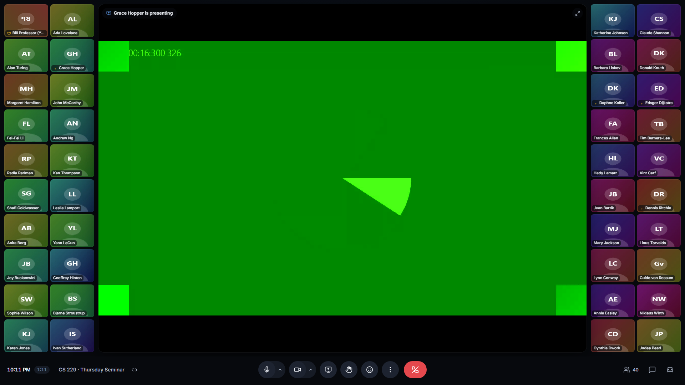

# Skypy

**Group video meetings where everyone keeps their seat.**

Skypy is a browser-based Zoom/Meet alternative built around two ideas:

1. **Every face stays on screen while someone shares.** The shared screen takes the
   middle; the class slides aside into columns on the left and right (or rows above and
   below). With 40 people you still see all 40 faces — no hidden second page.
2. **Assigned seats.** The room is a seating chart (5 rows × 8 seats by default). People
   land in *their* seat every time they dial in, and everyone sees the same arrangement —
   like a classroom where people sit in the same place every week.

People join with a link. Nothing to install.



---

## Contents

- [Features](#features)
- [Run it on your computer](#run-it-on-your-computer)
- [Put it online](#put-it-online)
- [Host guide](#host-guide)
- [How it works](#how-it-works)
- [Tests](#tests)
- [Configuration](#configuration)
- [Troubleshooting](#troubleshooting)

## Features

**Seats**
- Fixed seating chart, labelled like a theatre (row A is the front, A1…E8).
- People return to their seat automatically, matched by (in order): their personal
  link, the device they used last time, or the name they type.
- Hosts drag faces to move people; the move is remembered for future meetings.
- Paste a class list to pre-assign seats; copy each student's personal link.
- Empty seats stay visible so nobody's position shifts when others come and go
  (toggle with **E** if you prefer a compact view).
- More people than seats? Extras get a temporary seat or an "Extra" spot — nobody is
  ever hidden.

**Sharing**
- The screen goes in the middle; the left half of the class moves to the left column,
  the right half to the right (or front rows above, back rows below).
- Drag the gap between the faces and the screen to give either more room.
- Several people can share at once; switch between them with tabs.
- Hosts can **spotlight** someone's camera into the middle for everyone; anyone can
  **pin** a face to the middle just for themselves (double-click).

**Meeting tools**
- Chat (with history for late joiners), raised hands (in order), reactions.
- Host tools: mute one / mute all, lower hands, remove someone, make co-hosts,
  lock the room to the class list, limit screen sharing to hosts, export attendance (CSV).
- Device pickers for camera, microphone and speakers; mic level meter and speaker test.
- Automatic reconnection: a dropped connection keeps its seat and recovers on its own.
- Adaptive video: small tiles receive small video, so 40 cameras stay smooth.

## Run it on your computer

Requires [Node.js](https://nodejs.org) 20.12 or newer.

```bash
cd skypy
npm install
npm run dev
```

Open **http://localhost:5173**. On Windows and Linux, `npm run dev` downloads and starts a
local LiveKit media server automatically (on macOS run `brew install livekit` once).

To try a meeting with several people on one computer, open the link in a few browser
windows (use a private window for each extra "person").

> Browsers only allow cameras on `https://` sites or `localhost`, so other computers
> can't join a `localhost` meeting. To invite real people, put Skypy online (below).

## Put it online

Skypy has two parts: the **Skypy app** (this repo — pages, seats, chat) and a
**LiveKit media server** that carries the audio and video. Pick one of these setups.

### Option A — LiveKit Cloud + any Node host (recommended)

The most reliable setup: LiveKit Cloud handles video across firewalls and university
networks worldwide, and has a free tier.

1. Create a project at **https://cloud.livekit.io**. In *Settings → Keys* copy the
   **URL** (`wss://…livekit.cloud`), **API key** and **API secret**.
2. Deploy this repo to any Node host. With [Render](https://render.com): *New → Blueprint*,
   pick this repo (it reads [`render.yaml`](render.yaml)), and paste the three values.
   Railway, Fly.io or any VPS also work — use the [`Dockerfile`](Dockerfile) or run
   `npm ci && npm run build && npm start` with these environment variables:

   ```
   LIVEKIT_URL=wss://your-project.livekit.cloud
   LIVEKIT_API_KEY=…
   LIVEKIT_API_SECRET=…
   ```
3. Open your app's URL, start a meeting, share the link.

Seating charts are stored in `DATA_DIR` (default `./data`). Give it a persistent disk
so seats survive restarts (the Render blueprint includes one).

### Option B — Share from your laptop in one minute

Have LiveKit Cloud keys (step 1 above)? Put them in a `.env` file (copy
[`.env.example`](.env.example)), then:

```bash
npm run share
```

This builds Skypy, runs it on your computer and opens a free Cloudflare tunnel. It prints
a public `https://….trycloudflare.com` link anyone can join for as long as the window
stays open. Handy for a quick session; use Option A or C for a permanent address.

### Option C — Self-host everything on one server

For a server you control (any Linux VPS with Docker and a domain name):

```bash
cp deploy/.env.example deploy/.env      # set DOMAIN and a long random secret
docker compose -f deploy/docker-compose.yml --env-file deploy/.env up -d --build
```

This runs LiveKit, Skypy and Caddy (automatic HTTPS certificates) on one domain. Open
these firewall ports: `80/tcp`, `443/tcp`, `7881/tcp`, `3478/udp`, `50000-60000/udp`.
See [`deploy/`](deploy) for the configs.

## Host guide

*A one-page guide for the person running the meeting.*

**Start a room.** On the home page enter a name (e.g. *Thursday Seminar*), pick a size
(40 seats = 5 rows × 8) and press **Create meeting**. You're the host. Keep using the same
room every week — that's how seats are remembered. Your rooms are listed on the home page.

**Invite people.** Click the link icon next to the meeting name (bottom left) to copy the
meeting link. Anyone with it can join.

**Seats work like this.**
- The first time someone joins, they take the next free seat — and it becomes theirs.
- Next time they join (same device, or typing the same name) they sit there again.
- Seats of people who aren't here stay empty, showing their name faintly.

**Set up a seating chart** (optional). Open **Seats & settings** (chair icon, bottom right):
- *Paste a class list* — one name per line. Names fill seats front-to-back. Students who
  join with that name land in their seat.
- Drag names on the little seating chart to swap seats, or click a seat to type a name.
- Click a seat → *Copy personal link* to send a student a link that always seats them
  correctly, whatever name they type.
- *Lock to class list* — only people on the chart (and hosts) can join.

**Move people during the meeting.** *More (⋮) → Arrange seats*, then drag a face onto
another seat. Dropping onto someone swaps the two. Press **Done** when finished.

**When someone shares.** The screen appears in the middle and the class moves aside.
In *Seats & settings → Faces while sharing* choose side columns or above/below for
everyone (each person can override it in *More*). Drag the gap between faces and the
screen to resize.

**Moderate.** Hover a face → **⋯** for spotlight, mute, make co-host or remove.
The **People** panel lists raised hands in order and has *Mute all*. *Attendance (CSV)*
in Seats & settings downloads who was here and where they sat.

**Keyboard shortcuts.** `M` mute · `V` camera · `H` raise hand · `C` chat · `P` people ·
`E` show/hide empty seats · double-click a face to pin it.

**Host link.** *Seats & settings → Host link* gives a link that makes whoever opens it a
host of this room — use it to manage the room from another computer. Keep it private.

## How it works

```
 Browser (React)                          Skypy server (Node)               LiveKit (SFU)
 ───────────────                          ───────────────────               ─────────────
 Pre-join, meeting UI,       WebSocket    Rooms & seating charts (JSON),
 layout engine        ◀──────────────▶    seat assignment, chat, hands,
                                          moderation, access tokens   ───▶  server API
 Camera / mic / screen       WebRTC                                          (mute, remove)
 ◀──────────────────────────────────────────────────────────────────────▶   media routing,
                                                                             simulcast
```

- **Media** goes through [LiveKit](https://livekit.io), an open-source SFU. Each person
  uploads their camera once (in three sizes); everyone downloads only the size their
  tile needs. That is what makes 40 cameras on one screen practical.
- **Seats** live in the Skypy server ([`server/seating.ts`](server/seating.ts)):
  reservations (`seat → person`, saved to disk) and occupancy (`connection → seat`,
  live). Every change re-derives occupancy while moving as few people as possible.
- **Layout** ([`client/src/lib/layout.ts`](client/src/lib/layout.ts)) turns the seat grid
  into rectangles: the full grid normally; when someone shares, the left half of the class
  becomes a column block on the left and the right half on the right (or front/back rows
  above/below), sized to keep tiles as large as possible. Tiles keep their identity, so
  people glide into place.

Project layout:

```
client/        React app (Vite)       server/   Node server (Express + ws)
shared/        wire protocol          tests/    unit, end-to-end and load tests
scripts/       dev runner, LiveKit download, share tunnel, build
deploy/        docker compose + Caddy + LiveKit config for self-hosting
```

## Tests

```bash
npm test             # unit tests: seating rules and layout engine
npm run test:e2e     # end-to-end: real browsers with fake cameras (builds first)
npm run typecheck
```

The end-to-end suite covers returning to your seat, name matching, class lists and
personal links, drag-to-reseat, locked rooms, screen sharing geometry, spotlight, chat,
hands, reactions, mute/remove, co-hosts, page reloads and dropped connections.

Load test with a full class (one host browser + 39 simulated students, each with its own
synthetic camera):

```bash
npm run build && node scripts/dev.mjs --prod      # in one terminal
node tests/load/classroom.mjs --people 40         # in another
```

## Configuration

| Variable | Default | Purpose |
|---|---|---|
| `LIVEKIT_URL` | *(local dev server)* | LiveKit URL browsers connect to (`wss://…`) |
| `LIVEKIT_API_KEY` / `LIVEKIT_API_SECRET` | `devkey` / `secret` in dev | LiveKit credentials |
| `LIVEKIT_API_URL` | from `LIVEKIT_URL` | Where the server reaches LiveKit's API, if different |
| `PORT` | `3000` | HTTP port |
| `DATA_DIR` | `./data` | Where rooms and seating charts are saved |
| `SEAT_GRACE_SECONDS` | `30` | How long a dropped connection keeps its seat |
| `ROOM_CREATE_LIMIT` | `30` | Rooms one IP address may create per hour |
| `TRUST_PROXY` | private ranges | Express `trust proxy` setting when behind a proxy |

`GET /api/health` reports whether the server can reach LiveKit.

## Troubleshooting

- **"Skypy doesn't have permission to use your camera."** Click the camera icon in the
  address bar and allow access, then reload. Cameras only work on `https://` (or localhost).
- **"Audio and video are disconnected. Retrying…"** The browser can't reach the media
  server. Check `/api/health`; on self-hosted setups check the firewall ports above.
  Strict networks that block UDP work best with LiveKit Cloud (it relays over port 443).
- **Someone is in the wrong seat.** *Arrange seats* and drag them; it's remembered.
  If they joined under a different name, give them their personal link.
- **No sound.** If a banner says the browser paused sound, click *Turn on sound*.
  Check the speaker choice under the arrow next to the microphone button.
